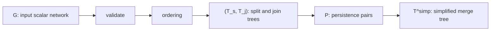

# AGENTS.md

This repository implements topographer, a Python-based **merge-tree toolkit for graphs and networks with scalar functions on vertices, edges, or both**. The package is based on **Topological Data Analysis** (TDA).

Specific `AGENTS.md` files are located in the `agents/` directory from the project root.

- `agents/NOTEBOOKS.md` to modify Marimo notebooks
- `agents/PACKAGE.md` for structuring package
- `agents/TESTING.md` for detailed testing instructions
- `agents/API.md` for public API and compatibility rules
- `agents/REVIEW.md` for the pull-request review checklist

## Project overview

- Load and validate a **Rustworkx graph with declared scalar functions on vertices, edges, or both**
- Compute **split trees** and **join trees**
- Find **persistence pairs** on a tree
- Perform **tree simplification** based on persistence or another edge attribute

The workflow diagram is below.

where:

- (G): input graph with declared scalar attributes
- (T_s): split tree
- (T_j): join tree
- (P): persistence pairs
- (T^{simp}): simplified merge tree

See `agents/PACKAGE.md` for more

## Build and test commands

- `uv add <package-name>` to add new packages (or edit pyproject.toml)
- `uv run ruff check --fix .` to lint code
- `uv run ruff format .` to format code
- `just` (no arguments) to list all commands
- `just style` to lint and then format code
- `just check` for formatting, linting, tests, and a package build
- `uv build` to build package artifacts
- `uv run pytest -q` for testing the code inside `tests/`

## Git workflow

- Start each task from a clean worktree on `main`.
- Run `git pull --ff-only origin main` before creating a task branch.
- Create a dedicated `codex/...` branch and never implement changes directly on
  `main`.
- Commit completed changes as a logical sequence so each verified step remains
  independently trackable.

## Testing instructions

- Use small graphs with normalized [0,1] scalar function attributes where practical
- Be deterministic
- Avoid randomness unless seeded
- Continue to pass with `uv run pytest -q`

See `agents/TESTING.md` for more

## Code style guidelines

- Small functions
- Clear variable names
- Docstrings for public functions
- Do not introduce deep class hierarchies
- Do not optimize prematurely
- Code should be understandable in ~10 minutes by a human.
- After tasks complete update `CHANGELOG.md`
- Keep plotting backend-independent: use IPlotX only to derive rooted-tree
  coordinates and Altair for public tree, graph, and persistence rendering.
- Generated Hamming assets are reproducible visual regressions. Regenerate
  them with `just docs-assets` whenever their data tables or plot specs change.
- Treat `output/` as entirely disposable local workspace. Never commit files
  from it; curated documentation regressions belong under `assets/`.
