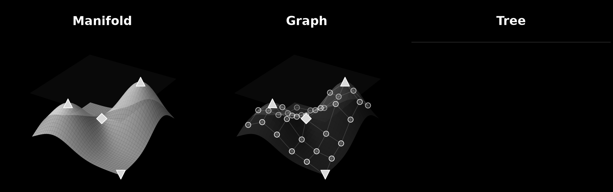

# Topographer

[](https://github.com/oist/topographer/blob/main/LICENSE.md)
[](https://doi.org/10.5281/zenodo.24548494)

Topographer builds merge trees for a graph that carries a scalar on each vertex. It is the software described in the accompanying methods paper: validate a scalar network, construct the join tree and the split tree, read off persistence, and simplify the tree with a bootstrap persistence band.



## Install

Python 3.11, 3.12 and 3.13 on Linux, macOS and Windows.

```bash
pip install "topographer @ git+https://github.com/oist/topographer.git"
```

Plotting (Altair charts) is optional:

```bash
pip install "topographer[plotting] @ git+https://github.com/oist/topographer.git"
```

The project name on PyPI is not available yet. Until it is, install from this Git repository.

## Quickstart

```python
import polars as pl

from topographer.graph import Graph, ScalarNetwork
from topographer.topology import ScalarNetworkTopology

nodes = pl.DataFrame({"id": ["a", "b", "c"], "height": [0.2, 0.9, 0.4]})
edges = pl.DataFrame({"source": ["a", "b"], "target": ["b", "c"]})
graph = Graph.from_tables(
    nodes,
    edges,
    vertex_id_col="id",
    source_id_col="source",
    target_id_col="target",
    vertex_attribute_cols=["height"],
)
network = ScalarNetwork(graph, scalar_attr="height")
split_tree = ScalarNetworkTopology(network).split_tree()
print(split_tree.persistence())
```

The same snippet is executed by the test suite.

## Related packages

- [barseqfit](https://github.com/oist/barseqfit): estimates fitness and fitness differences from barcode sequencing counts; its output tables are one source of the scalar networks topographer analyses.

## Publications using this package

Dubanevics et al. "Topological characterization of combinatorial fitness landscapes using merge trees." Manuscript in preparation (2026). Code: https://github.com/igorsdub/dubanevics2026topological

## Cite

Cite the software with the metadata in [`CITATION.cff`](https://github.com/oist/topographer/blob/main/CITATION.cff). The Zenodo concept DOI, [10.5281/zenodo.24548494](https://doi.org/10.5281/zenodo.24548494), cites all versions and always resolves to the latest. The version DOI, [10.5281/zenodo.24548495](https://doi.org/10.5281/zenodo.24548495), cites version 0.5.1 specifically. `CITATION.cff` has the machine-readable form. The methods paper will be added when it exists.

## Development

```bash
uv sync --extra dev --extra docs
uv run pytest -q
```

See [CONTRIBUTING.md](https://github.com/oist/topographer/blob/main/CONTRIBUTING.md).
